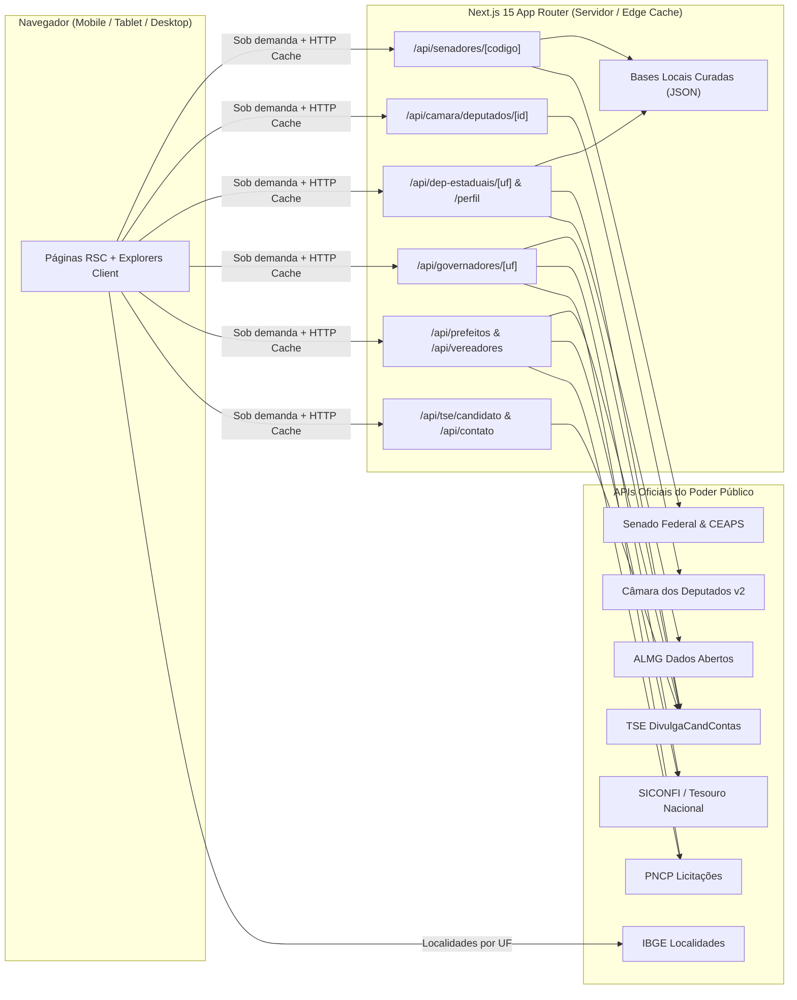
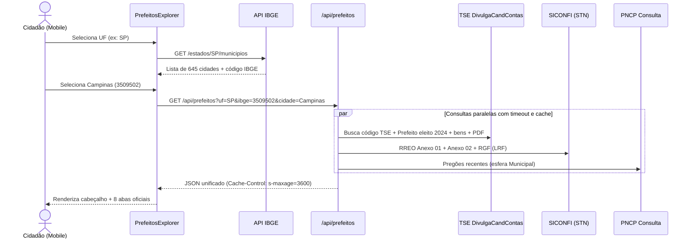

# Arquitetura & Design System — Fiscaliza Brasil

Este documento detalha a arquitetura de software, as decisões técnicas (ADRs), a estrutura de diretórios, o fluxo de dados sob demanda e o Design System responsivo da plataforma.

---

## 1. Visão Arquitetural (BFF em Next.js App Router)

O portal utiliza o **Next.js 15 App Router** combinando **React Server Components (RSC)** para páginas leves e SEO, com **Route Handlers (`/api/*`) atuando como Backend-for-Frontend (BFF)**.



---

## 2. Fluxo de Consulta Sob Demanda (Exemplo: Prefeitos e Vereadores)



---

## 3. Decisões Arquiteturais (ADRs)

### ADR-01: Next.js App Router como BFF em vez de fetch direto no navegador
- **Contexto:** APIs como o **TSE DivulgaCandContas** bloqueiam CORS e rejeitam `User-Agent` não padrão; já a **CEAPS do Senado** retorna ~9 MB por ano.
- **Decisão:** Todas as integrações governamentais (exceto IBGE Localidades) passam pelos Route Handlers em `src/app/api/*`.
- **Consequências:**
  - Zero erro de CORS no navegador.
  - Payload enxuto enviado ao celular (ex.: apenas 1 senador filtrado do índice CEAPS em memória).
  - Cabeçalho `Cache-Control: public, s-maxage=3600, stale-while-revalidate=86400` protege contra rajadas de acesso e quedas momentâneas dos portais públicos.

### ADR-02: Falha Graciosa (Graceful Degradation) por Fonte
- **Contexto:** Portais governamentais sofrem instabilidades frequentes (ex.: ALESP retornando HTTP 503 em períodos de pico).
- **Decisão:** Cada cliente em `src/lib/*` usa `AbortController` com timeout explícito (9s–18s) e `.catch(() => null)` isolado em `Promise.all`.
- **Consequência:** Se o PNCP ou o SICONFI falhar momentaneamente, o perfil do político continua abrindo com os dados do TSE e exibe aviso claro na aba afetada, sem derrubar a página inteira.

### ADR-03: Componentização Única de Perfis (`PerfilAbas`) e Cabeçalhos (`PageHero`)
- **Decisão:** Todas as 6 esferas políticas compartilham o mesmo sistema de abas acessíveis (`role="tablist"`, teclado `Escape` em modais) e todas as 14 páginas internas compartilham `<PageHero />`.
- **Consequência:** Consistência visual total, manutenção centralizada e bundle compartilhado mínimo (~103 kB).

### ADR-04: Agrupamento Editorial Automático em Páginas Institucionais
- **Decisão:** `PaginaInstitucionalView` lê os blocos estruturados de `src/data/paginas-institucionais.json`, agrupa por seções `h1`/`h2` em cards numerados (`01`, `02`...) e gera automaticamente o índice lateral fixo (`sticky`) no desktop e um `<details>` colapsável no mobile/tablet.

---

## 4. Estrutura do Projeto

```text
src/
├── app/
│   ├── api/
│   │   ├── camara/deputados/[id]/route.ts   # API v2 Câmara (perfil, projetos, comissões, frentes, presença, votos, CEAP)
│   │   ├── contato/route.ts                 # POST JSON e multipart/form-data (upload até 5 anexos) + protocolo
│   │   ├── dep-estaduais/[uf]/route.ts      # Bancada sob demanda por UF + detalhe ALESP
│   │   ├── dep-estaduais/[uf]/perfil/route.ts # Perfil estadual unificado (TSE + ALESP + ALMG)
│   │   ├── governadores/[uf]/route.ts       # Governador (TSE 2022/2026 + SICONFI RREO/LRF + PNCP)
│   │   ├── prefeitos/route.ts               # Prefeito (TSE 2024 + SICONFI RREO/LRF + PNCP)
│   │   ├── senadores/[codigo]/route.ts      # Senador (Emendas + Autorias + Comissões + Votações + CEAPS)
│   │   ├── tse/candidato/route.ts           # Detalhe individual de candidato TSE (usado em Vereadores)
│   │   └── vereadores/route.ts              # Vereadores eleitos 2024 + Orçamento Legislativo SICONFI
│   ├── senadores/page.tsx                   # 6 Esferas Políticas
│   ├── deputados-federais/page.tsx
│   ├── dep-estaduais/page.tsx
│   ├── governadores/page.tsx
│   ├── prefeitos/page.tsx
│   ├── vereadores/page.tsx
│   ├── sobre-o-fiscaliza-brasil/page.tsx    # 8 Páginas Institucionais
│   ├── politica-explicada/page.tsx
│   ├── participe/page.tsx
│   ├── denuncias/page.tsx
│   ├── quem-apoia-o-fiscaliza-brasil/page.tsx
│   ├── quem-patrocina-o-fiscaliza-brasil/page.tsx
│   ├── contato/page.tsx
│   ├── privacidade/page.tsx
│   ├── globals.css                          # Tokens Tailwind v4, bg-civic-grid, card-elevated, tabular-nums
│   ├── layout.tsx                           # Fontes Inter + Plus Jakarta Sans, SiteHeader, SiteFooter
│   ├── not-found.tsx
│   └── page.tsx                             # Home editorial (7 faixas full-width / 10 blocos)
├── components/
│   ├── camara/DeputadosFederaisExplorer.tsx
│   ├── dados/                               # Painéis reutilizáveis de dados oficiais
│   │   ├── PainelContratacoesPncp.tsx
│   │   ├── PainelEleitoralTSE.tsx
│   │   ├── PainelFiscalizacaoOficial.tsx
│   │   ├── PainelFiscalSiconfi.tsx
│   │   └── PainelTrajetoriaTSE.tsx
│   ├── deputados/DeputadosExplorer.tsx
│   ├── governadores/GovernadoresExplorer.tsx
│   ├── home/BuscaRapidaHome.tsx
│   ├── institucional/
│   │   ├── FormularioCidadao.tsx            # Formulário acessível com drag-and-drop de anexos e links
│   │   ├── PaginaInstitucionalView.tsx      # Leitura editorial em cards + índice sticky / mobile
│   │   └── ParticipeInterativo.tsx          # 4 cards interativos sincronizados com o formulário
│   ├── layout/
│   │   ├── PageHero.tsx
│   │   ├── SiteFooter.tsx
│   │   └── SiteHeader.tsx
│   ├── municipios/
│   │   ├── PrefeitosExplorer.tsx
│   │   └── VereadoresExplorer.tsx
│   ├── senadores/SenadoresExplorer.tsx
│   └── ui/
│       ├── AvisoFiscalizacao.tsx
│       └── PerfilAbas.tsx
├── data/                                    # Bases estruturadas curadas (carregadas sob demanda no server)
│   ├── alesp-detalhes.json                  # 94 deputados SP: bio, 12 folhas salariais e emendas Sefaz-SP
│   ├── assembleias.json                     # 27 Assembleias Legislativas (sigla, vagas, portal)
│   ├── deputados-estaduais.json             # 1.067 parlamentares indexados por UF
│   ├── deputados-federais.json              # 513 deputados federais (57ª Legislatura)
│   ├── governadores.json                    # 27 governadores em exercício
│   ├── paginas-institucionais.json          # Conteúdo estruturado das 8 páginas institucionais
│   ├── senadores.json                       # 81 senadores em exercício
│   └── senadores-emendas.json               # Emendas parlamentares traduzidas em linguagem simples
├── lib/                                     # Clientes de API, normalização e formatação
│   ├── abas.ts                              # Definições e explicações didáticas das abas das 6 esferas
│   ├── almg.ts                              # Cliente API Dados Abertos ALMG (MG)
│   ├── camara.ts                            # Votações nominais em plenário da Câmara com cache
│   ├── formatters.ts                        # Moeda BRL completa/compacta, percentual, data BR
│   ├── ibge.ts                              # Cliente IBGE Localidades com cache por UF
│   ├── pncp.ts                              # Cliente PNCP (licitações por UF/município/esfera)
│   ├── senado.ts                            # Cliente Senado (autorias, votações, comissões, CEAPS)
│   ├── siconfi.ts                           # Cliente SICONFI (RREO Anexo 01/02 + RGF LRF)
│   ├── tse.ts                               # Cliente TSE DivulgaCandContas (2022, 2024 e 2026)
│   └── ufs.ts                               # 27 UFs: código IBGE, região, TCE, Portal da Transparência
└── types/
    └── politicos.ts                         # Tipagem estrita de domínio (zero `any`)
```

---

## 5. Design System & Padrões de Responsividade

- **Paleta institucional:**
  - `brand-navy` (`#06182c`) — autoridade institucional, cabeçalhos e contraste alto.
  - `brand-blue` (`#123f73`) — ações interativas, links e hierarquia secundária.
  - `brand-emerald` (`#087f5b`) — transparência, dados verificados e CTAs principais.
  - `brand-alert` (`#d97706`) — aviso editorial de imparcialidade.
  - `brand-surface` (`#f6f8fa`) — alternância sutil com faixas `#ffffff`.
- **Tipografia:** `Plus Jakarta Sans` (títulos e display) + `Inter` (corpo e leitura longa) com `tabular-nums` em valores financeiros, percentuais, protocolos e contadores.
- **Mobile & Tablet First (360px / 768px / 1024px):**
  - `overflow-x: clip` global para zero rolagem horizontal acidental.
  - Inputs e selects com `16px` no mobile (`text-base sm:text-sm`) evitando zoom automático no iOS Safari.
  - Alvos de toque `≥ 44px` em botões, seletores, links do menu mobile e abas (`snap-x snap-mandatory`).
  - Sumário colapsável (`<details>`) em páginas longas para mobile e tablet, substituindo o índice lateral desktop.
  - Respeito a `prefers-reduced-motion` e foco visível WCAG 2.2 AA.
